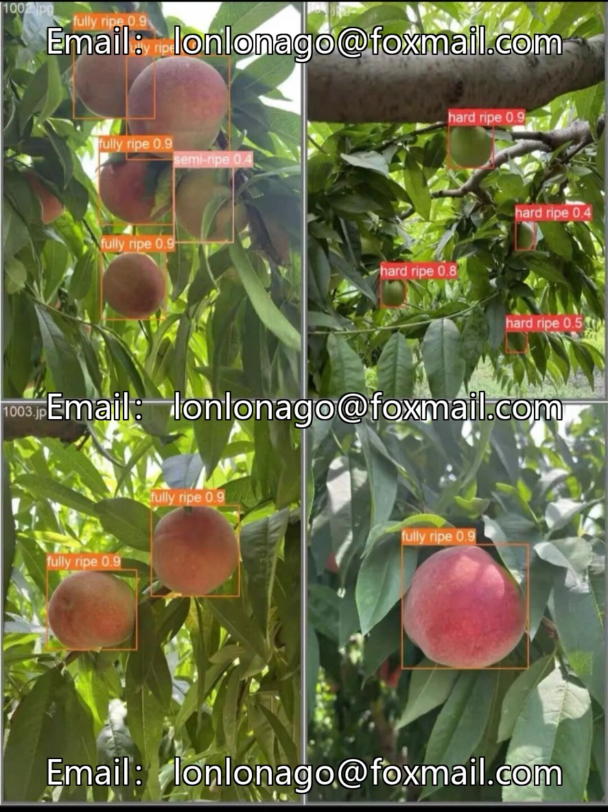
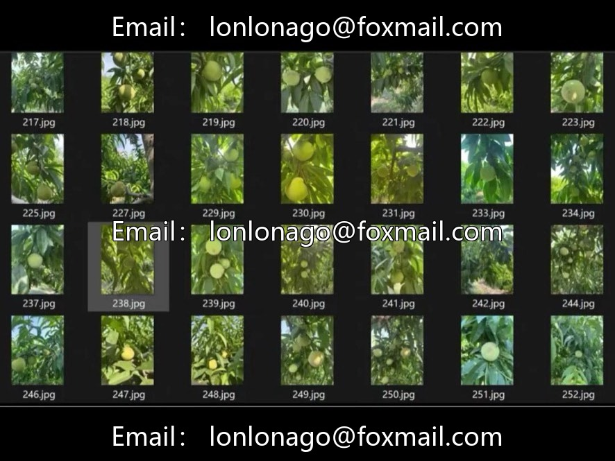
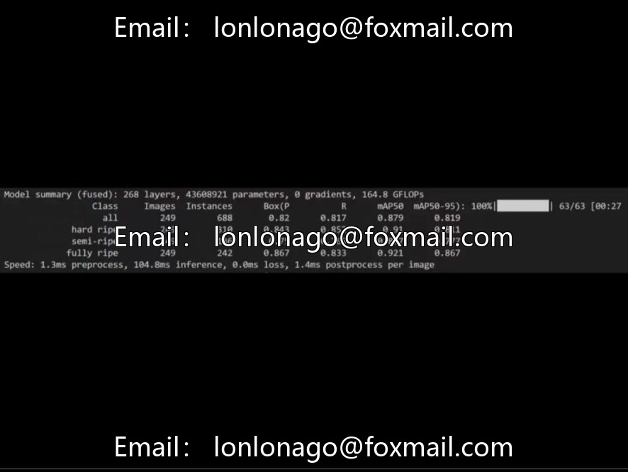
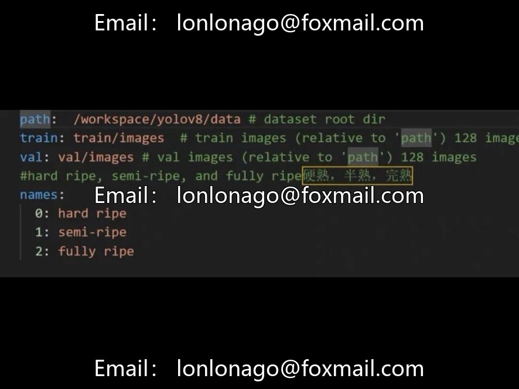

# Peach ripeness detection dataset and model, issue 10073

## Body

Peach ripeness detection dataset and model, issue 10073

Agricultural scene: Peach maturity grading, target detection + fine classification, 1245 high-quality images, 3 categories of maturity annotations, YOLOv8s model weights, ready to use, directly inference or fine-tuning.

Category System
Hard-ripe (Hard-ripe) - Ripe flesh with a firm texture, green or just turning color on the skin.
Half-ripe (Half-ripe) - Parts turning red/yellow, flesh softening.
Full-ripe (Full-ripe) - Fully colored, soft flesh, rich aroma

Dataset Specifications and Performance
Total number of images: 1245
Annotation format: YOLO format (.txt), normalized coordinates
Data source: Network collection + on-site photography, including watermelon, yellow peach, and persimmon varieties
Scene characteristics: Natural lighting, indoor/outdoor, single/multiple fruits, coexistence of different maturity stages
Recommended splitting ratios: 8:1:1 or 7:2:1 (Training/Validation/Test)
Baseline model: YOLOv8s (switchable between n/m/l/x)
Number of training epochs: 100 (can continue training)
Detection accuracy: mAP@0.5 = 0.879
Deliverable content: Dataset + best.pt weights + training logs (loss/PR/mAP curves) + usage instructions

Applicable tasks and scenarios
Fruit orchard picking, sorting and packaging, e-commerce warehousing, scientific breeding, etc., automatic classification, reduce labor costs, improve product yield.

Usage Recommendations
Ready-to-use, complete dataset + high-precision weights, no need for secondary labeling. It is recommended to supplement images under different lighting and occlusion conditions to enhance generalization. LLM can be used to generate decision criteria and storage suggestions. Supports customization of "overripe" levels, training other YOLO versions, model lightweight deployment, etc.

Peach maturity detection YOLOv8 dataset and model, issue 10073

Virtual materials, once sold, are non-refundable.
Interested friends, click "I want" to proceed.

## Images

## Payment

Here is a pay link on Stripe ( https://buy.stripe.com/3cs8yP7sY87d0vu9AB ). Please contact me lonlonago@foxmail.com after funding $89, and I will send you a complete data files , thank you!

